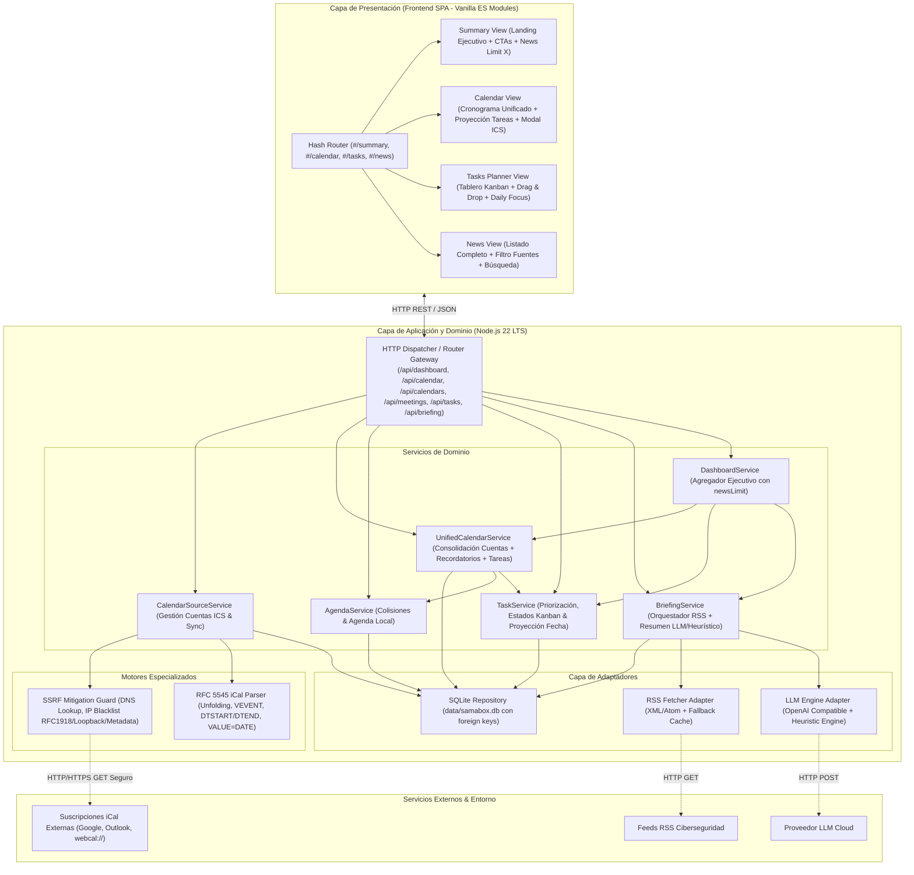
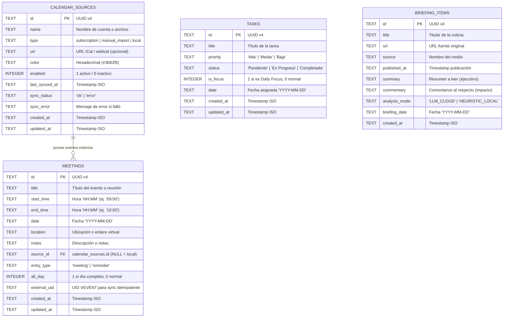
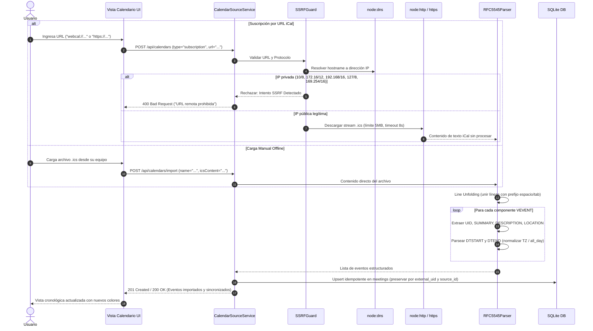

# Architecture & Design Document - Samabox V2

## 1. Visión General y Principios de Diseño

**Samabox V2** es una evolución arquitectónica de la plataforma web de inicio de jornada (*Morning Kickoff Dashboard*). Su objetivo central es descomprimir la sobrecarga visual de la pantalla única de la versión 1, dividiéndola en una experiencia fluida multipantalla (SPA con Hash Router nativo) y permitiendo conectar o compartir múltiples calendarios mediante un **enfoque híbrido iCal (RFC 5545)**: suscripción automática por URL (`https://` y `webcal://`) con protección SSRF y carga manual de archivos `.ics` para soporte offline total.

### Principios Rectores V2:
1. **Cero Dependencias Externas (Pure Node.js v22 LTS)**: Se mantiene la filosofía de baseline: servidor HTTP nativo (`node:http`), base de datos SQLite integrada (`node:sqlite`), suite de testing nativa (`node:test`, `node:assert/strict`), resolución DNS segura (`node:dns`) y criptografía nativa (`node:crypto`). Sin frameworks pesados ni dependencias binarias externas.
2. **Descompresión Cognitiva & SPA Multipantalla**: El frontend se organiza como una Single Page Application (SPA) basada en Vanilla ES Modules sin bundlers ni transpiladores. Un Hash Router ligero administra las 4 vistas principales (`#/summary`, `#/calendar`, `#/tasks`, `#/news`).
3. **Enfoque Híbrido de Calendarios con Detección Global de Solapamientos**: Admite suscripción remota periódica vía URL e importación manual offline de archivos `.ics`. Las reuniones de todas las fuentes se consolidan en una línea de tiempo uniforme, detectando colisiones de horario entre reuniones locales y externas.
4. **Proyección Bidireccional de Tareas y Calendario**: Las tareas planificadas para una fecha se proyectan de forma automática en la pantalla de Calendario. Las modificaciones de estado (en Kanban o en Calendario) impactan en tiempo real todas las vistas.
5. **Seguridad y Mitigación Estricta de SSRF**: Toda URL externa de calendario es validada rigurosamente a nivel de protocolo, esquema y resolución DNS para bloquear el acceso a redes privadas (RFC 1918), interfaces loopback y endpoints de metadatos de proveedores cloud.
6. **Evolución Aditiva & Compatibilidad Hacia Atrás (Zero Regression)**: Se preserva la compatibilidad total con los contratos del baseline v1, garantizando que los 130 tests existentes continúen ejecutándose y pasando al 100%.

---

## 2. Diagramas de Arquitectura (Mermaid)

### 2.1 Diagrama de Contenedores y Capas (C4 Level 2)



---

### 2.2 Diagrama de Entidad-Relación (ERD) Base de Datos SQLite V2



---

### 2.3 Flujo del Parser iCal RFC 5545 con Mitigación SSRF



---

### 2.4 Arquitectura del Frontend SPA y Hash Router

```mermaid
flowchart TD
    Init(["Carga de la aplicación (GET /)"]) --> ReadHash["Leer window.location.hash"]
    ReadHash --> RouteSwitch{"Valor del Hash"}
    
    RouteSwitch -- "" o "#/" o "#/summary" --> RenderSummary["Renderizar Landing / Resumen (#/summary)\n- X Noticias con CTA a #/news\n- Próximas citas con CTA a #/calendar\n- Progreso tareas con CTA a #/tasks"]
    RouteSwitch -- "#/calendar" --> RenderCalendar["Renderizar Calendario (#/calendar)\n- Cronograma con colores de cuenta\n- Alertas de conflicto horario\n- Carril de recordatorios / all-day\n- Proyección de tareas asignadas\n- Modal gestor de cuentas ICS"]
    RouteSwitch -- "#/tasks" --> RenderTasks["Renderizar Planner Kanban (#/tasks)\n- Columnas: Pendiente, En Progreso, Completada\n- Tarjetas Drag & Drop y botones accesibles\n- Daily Focus y fecha sincronizada"]
    RouteSwitch -- "#/news" --> RenderNews["Renderizar Noticias Dedicadas (#/news)\n- Listado espacioso completo\n- Filtro interactivo por fuente\n- Buscador en tiempo real\n- Botón forzar refresco"]
    RouteSwitch -- Otro --> DefaultRoute["Redirigir a #/summary"]
    
    EventHashChange["Evento hashchange en window"] --> ReadHash
```

---

## 3. Stack Tecnológico y Justificación

| Componente | Tecnología | Justificación y Ventajas |
| :--- | :--- | :--- |
| **Runtime Base** | **Node.js v22 LTS** | Soporte para ES Modules nativos, `node:sqlite` sin dependencias binarias externas, `fetch` nativo y `node:test`. |
| **Persistencia** | **SQLite integrado (`node:sqlite`)** | Cero configuración, transaccional, ultrarrápido y soporte idéntico en desarrollo, pruebas (`:memory:`) y producción (`data/samabox.db`). |
| **Testing Framework** | **`node:test` + `node:assert/strict`** | Ejecución de tests en milisegundos, fixtures y mocks nativos, cero peso adicional de node_modules. |
| **Parser iCal / RFC 5545** | **Motor Nativo Node.js (`src/domain/ical-parser.js`)** | Implementación RFC 5545 pura para unfolding de líneas, parseo de bloques `VEVENT`, marcas de tiempo ISO/UTC/locales y eventos de día completo, sin depender de librerías obsoletas o infladas. |
| **Mitigación SSRF** | **Guarda de Red Nativo (`src/domain/ssrf-guard.js`)** | Validación de esquemas permitidos (`https:`, `webcal:`), resolución DNS con `node:dns` y descarte inmediato de IPs privadas RFC 1918, loopbacks y cloud metadata. |
| **Frontend Web** | **Vanilla Modern ES Modules + CSS Grid/Flexbox** | Cero tiempo de build, ejecución directa en navegador moderno, navegación instantánea mediante Hash Router SPA y Drag & Drop nativo HTML5. |
| **Adaptador IA** | **OpenAI Compatible Client + Heuristic Engine** | Inferencia de resúmenes y análisis táctico con conmutación resiliente a heurística de palabras clave ante falta de conexión o claves. |

---

## 4. Estructura de Directorios del Proyecto V2

```
samabox/
├── .gitignore
├── .env.example
├── package.json
├── README.md
├── docs/
│   ├── PRD.md
│   └── ARCHITECTURE.md
├── data/
│   └── .gitkeep
├── src/
│   ├── config.js                           # Configuración centralizada y variables de entorno
│   ├── server.js                          # Punto de entrada y arranque del servidor HTTP
│   ├── app.js                             # Enrutador HTTP, middlewares, CORS y servicio estático
│   ├── domain/                            # Modelos de dominio puros y motores de negocio
│   │   ├── meeting.js                     # Validación y algoritmo de detección de solapamientos
│   │   ├── task.js                        # Validaciones, prioridades, ordenamiento inteligente y stats
│   │   ├── briefing-item.js               # Normalización del briefing de seguridad
│   │   ├── ical-parser.js                 # Parser nativo RFC 5545 (unfolding, VEVENT, fechas)
│   │   └── ssrf-guard.js                  # Validador de URLs y protección anti-SSRF con DNS lookup
│   ├── services/                          # Casos de uso de la aplicación
│   │   ├── agenda-service.js              # CRUD de agenda y resolución de conflictos
│   │   ├── calendar-source-service.js     # Gestión de suscripciones e importaciones manuales ICS
│   │   ├── unified-calendar-service.js    # Consolidación de reuniones, recordatorios y tareas
│   │   ├── task-service.js                # Lógica de tareas, ciclo de vida Kanban y proyección
│   │   ├── briefing-service.js            # Orquestador RSS + LLM + Caché
│   │   └── dashboard-service.js           # Métricas del arranque ejecutivo con newsLimit
│   ├── adapters/                          # Adaptadores de infraestructura
│   │   ├── db.js                          # Repositorio SQLite, migraciones v1->v2 y consultas
│   │   ├── rss-adapter.js                 # Lector de feeds RSS/Atom y fallback offline
│   │   └── llm-adapter.js                 # Adaptador LLM (Cloud + Motor Heurístico)
│   ├── utils/
│   │   └── sanitizer.js                   # Sanitizador XSS (stripHtmlTags, escapeHtml, sanitizeUrl)
│   └── public/                            # Frontend SPA Vanilla ES Modules
│       ├── index.html                     # Shell principal SPA (Navbar, contenedor de vistas y modales)
│       ├── css/
│       │   └── styles.css                 # Sistema de diseño, CSS Grid, Kanban columns, dark theme
│       └── js/
│           ├── router.js                  # Hash Router (#/summary, #/calendar, #/tasks, #/news)
│           ├── api.js                     # Cliente HTTP para toda la API REST v2
│           ├── components/
│           │   ├── summary-view.js        # Vista Resumen: Widgets ejecutivos con CTAs
│           │   ├── calendar-view.js       # Vista Calendario: Cronograma, proyección de tareas y cuentas
│           │   ├── tasks-view.js          # Vista Planner: Tablero Kanban Drag & Drop
│           │   ├── news-view.js           # Vista Noticias: Listado completo, buscador y filtros
│           │   └── calendar-modal.js      # Modal para conectar URLs iCal o subir archivo .ics
│           └── app.js                     # Inicializador cliente, suscripción a eventos de hash y fecha
└── tests/
    ├── helpers/
    │   ├── test-db.js                     # SQLite en memoria para pruebas
    │   └── test-fixtures.js               # Mocks de feeds RSS y archivos .ics RFC 5545
    ├── unit/
    │   ├── meeting-domain.test.js         # Tests de solapamiento cronológico
    │   ├── task-domain.test.js            # Tests de ciclo de vida Kanban y Daily Focus
    │   ├── ical-parser.test.js            # Tests exhaustivos del parser RFC 5545
    │   ├── ssrf-guard.test.js             # Tests de bloqueo SSRF e IPs privadas
    │   ├── sanitizer.test.js              # Tests de sanitización XSS
    │   └── llm-adapter.test.js            # Tests del adaptador LLM y motor heurístico
    └── integration/
        ├── agenda-api.test.js             # Tests de endpoints /api/meetings
        ├── calendar-sources-api.test.js   # Tests de CRUD, import y sync de cuentas iCal
        ├── unified-calendar-api.test.js   # Tests de consolidación de eventos y proyección de tareas
        ├── task-api.test.js               # Tests de endpoints /api/tasks y cambios Kanban
        ├── briefing-api.test.js           # Tests de /api/briefing y refresh
        ├── dashboard-api.test.js          # Tests de /api/dashboard/summary con newsLimit
        ├── operational-hardening.test.js  # Tests de seguridad HTTP, health check y payload limits
        └── e2e-morning-kickoff.test.js    # Test de flujo end-to-end completo
```

---

## 5. Modelo de Datos y Esquema SQLite V2

El esquema evoluciona asegurando compatibilidad total mediante migraciones automáticas idempotentes (`ALTER TABLE` con verificación previa si las columnas ya existen):

```sql
-- Habilitar llaves foráneas y modo WAL para concurrencia óptima
PRAGMA foreign_keys = ON;
PRAGMA journal_mode = WAL;

-- 1. Tabla: calendar_sources (Fuentes y Cuentas de Calendario)
CREATE TABLE IF NOT EXISTS calendar_sources (
    id TEXT PRIMARY KEY,
    name TEXT NOT NULL,
    type TEXT NOT NULL CHECK(type IN ('subscription', 'manual_import', 'local')),
    url TEXT DEFAULT NULL,
    color TEXT NOT NULL DEFAULT '#3b82f6',
    enabled INTEGER NOT NULL DEFAULT 1,
    last_synced_at TEXT DEFAULT NULL,
    sync_status TEXT NOT NULL DEFAULT 'ok' CHECK(sync_status IN ('ok', 'error')),
    sync_error TEXT NOT NULL DEFAULT '',
    created_at TEXT NOT NULL,
    updated_at TEXT NOT NULL
);

-- 2. Tabla: meetings (Agenda extendida para soporte local y externo)
CREATE TABLE IF NOT EXISTS meetings (
    id TEXT PRIMARY KEY,
    title TEXT NOT NULL,
    start_time TEXT NOT NULL,       -- Formato 'HH:MM' (ej. '09:00')
    end_time TEXT NOT NULL,         -- Formato 'HH:MM' (ej. '10:00')
    date TEXT NOT NULL,             -- Formato 'YYYY-MM-DD'
    location TEXT DEFAULT '',
    notes TEXT DEFAULT '',
    source_id TEXT DEFAULT NULL REFERENCES calendar_sources(id) ON DELETE CASCADE,
    entry_type TEXT NOT NULL DEFAULT 'meeting' CHECK(entry_type IN ('meeting', 'reminder')),
    all_day INTEGER NOT NULL DEFAULT 0,
    external_uid TEXT DEFAULT NULL,
    created_at TEXT NOT NULL,
    updated_at TEXT NOT NULL
);

-- 3. Tabla: tasks (Tareas y Proyección Diaria)
CREATE TABLE IF NOT EXISTS tasks (
    id TEXT PRIMARY KEY,
    title TEXT NOT NULL,
    priority TEXT NOT NULL CHECK(priority IN ('Alta', 'Media', 'Baja')),
    status TEXT NOT NULL CHECK(status IN ('Pendiente', 'En Progreso', 'Completada')),
    is_focus INTEGER NOT NULL DEFAULT 0,
    date TEXT NOT NULL,             -- Formato 'YYYY-MM-DD'
    created_at TEXT NOT NULL,
    updated_at TEXT NOT NULL
);

-- 4. Tabla: briefing_items (Noticias de Ciberseguridad Procesadas)
CREATE TABLE IF NOT EXISTS briefing_items (
    id TEXT PRIMARY KEY,
    title TEXT NOT NULL,
    url TEXT NOT NULL,
    source TEXT NOT NULL,
    published_at TEXT NOT NULL,
    summary TEXT NOT NULL,
    commentary TEXT NOT NULL,
    analysis_mode TEXT NOT NULL,    -- 'LLM_CLOUD' o 'HEURISTIC_LOCAL'
    briefing_date TEXT NOT NULL,
    created_at TEXT NOT NULL
);

-- Índices de Rendimiento
CREATE INDEX IF NOT EXISTS idx_meetings_date ON meetings(date);
CREATE INDEX IF NOT EXISTS idx_meetings_source_id ON meetings(source_id);
CREATE INDEX IF NOT EXISTS idx_meetings_external_uid ON meetings(external_uid);
CREATE INDEX IF NOT EXISTS idx_tasks_date ON tasks(date);
CREATE INDEX IF NOT EXISTS idx_briefing_date ON briefing_items(briefing_date);
```

---

## 6. Especificación del Parser RFC 5545 y Mitigación SSRF

### 6.1 Parser RFC 5545 Puro (`src/domain/ical-parser.js`)
El parser se implementa sin dependencias siguiendo la norma RFC 5545:
1. **Line Unfolding**: Normaliza terminadores de línea a `\n` y fusiona cualquier línea que comience con un espacio o tabulación con la anterior (`line.replace(/\r?\n[ \t]/g, '')`).
2. **Componentes y Propiedades**:
   - Delimitación por bloques `BEGIN:VEVENT` y `END:VEVENT`.
   - Propiedades obligatorias y opcionales: `UID`, `SUMMARY`, `DESCRIPTION`, `LOCATION`, `DTSTART`, `DTEND`, `DURATION`.
   - Soporte para desescape de caracteres iCal (`\,` $\to$ `,`, `\;` $\to$ `;`, `\n` o `\N` $\to$ salto de línea, `\\` $\to$ `\`).
3. **Parseo y Normalización de Marcas Temporales**:
   - `DTSTART;VALUE=DATE:20261102`: Evento de día completo $\to$ `date: '2026-11-02'`, `allDay: 1`, `startTime: '00:00'`, `endTime: '23:59'`.
   - `DTSTART:20261102T093000Z` o `DTSTART;TZID=...:20261102T093000`: Se extrae la fecha `2026-11-02` y la hora `09:30`.
   - Si no existe `DTEND`, se calcula a partir de `DURATION` (ej. `PT1H30M`) o se asigna 1 hora por defecto si no es de día completo.

### 6.2 Mitigación Robusta Anti-SSRF (`src/domain/ssrf-guard.js`)
Para cualquier sincronización remota por URL:
1. **Esquemas Permitidos**: Solo `https:` y `http:`. Si la URL inicia con `webcal://`, se transforma automáticamente a `https://`.
2. **Resolución DNS y Validación de Destino**:
   - Se realiza `dns.lookup(hostname)` previo a la conexión.
   - Si la IP resultante pertenece a rangos reservados o privados, se rechaza inmediatamente:
     - `127.0.0.0/8` (Loopback)
     - `10.0.0.0/8`, `172.16.0.0/12`, `192.168.0.0/16` (RFC 1918)
     - `169.254.0.0/16` (Link-Local & Cloud Metadata AWS/GCP/Azure)
     - `0.0.0.0/8`, `100.64.0.0/10` (Carrier-grade NAT)
     - `::1`, `fc00::/7`, `fe80::/10` (IPv6 loopback y link-local)
3. **Límites de Seguridad en la Petición**:
   - Timeout estricto de conexión y transferencia: 8,000 ms.
   - Límite máximo de descarga de 5 MB para evitar ataques de denegación de servicio por descompresión.

---

## 7. Especificación de la API REST V2

### 7.1 Endpoints de Calendario y Fuentes

| Método | Endpoint | Descripción | Body / Parámetros | Respuesta Exitosa |
| :--- | :--- | :--- | :--- | :--- |
| `GET` | `/api/calendars` | Lista todas las fuentes de calendario configuradas con métricas | Ninguno | `200 OK` - `[ { id, name, type, url, color, enabled, eventCount, lastSyncedAt, syncStatus } ]` |
| `POST` | `/api/calendars` | Registra una nueva fuente (suscripción URL) | `{ name, type, url, color }` | `201 Created` - `{ calendarSource }` |
| `GET` | `/api/calendars/:id` | Detalle de una fuente de calendario | Ninguno | `200 OK` - `{ calendarSource }` |
| `PATCH` | `/api/calendars/:id` | Modifica configuración de la fuente (color, nombre, enabled) | `{ name?, color?, enabled? }` | `200 OK` - `{ calendarSource }` |
| `DELETE` | `/api/calendars/:id` | Elimina la fuente y todos sus eventos sincronizados | Ninguno | `204 No Content` |
| `POST` | `/api/calendars/:id/sync` | Fuerza sincronización remota de la suscripción | Ninguno | `200 OK` - `{ synced: true, eventCount, syncedAt }` |
| `POST` | `/api/calendars/import` | Importa manualmente archivo o contenido `.ics` offline | `{ name, color, icsContent }` | `201 Created` - `{ calendarSource, importedCount }` |
| `GET` | `/api/calendar/unified` | **Endpoint Unificado**: Devuelve reuniones consolidadas, recordatorios, colisiones y tareas proyectadas para la fecha | Query: `?date=YYYY-MM-DD` | `200 OK` - `{ date, meetings: [...], reminders: [...], tasks: [...], sources: [...], stats }` |

### 7.2 Endpoints del Baseline Preservados & Actualizados

| Método | Endpoint | Evolución V2 | Parámetros / Respuesta |
| :--- | :--- | :--- | :--- |
| `GET` | `/api/dashboard/summary` | Soporta parámetro opcional `newsLimit=X` (por defecto 3) y métricas de calendario unificado | Query: `?date=YYYY-MM-DD&newsLimit=3` $\to$ `{ date, briefingCount, meetingStats, taskStats, mode, topNews: [...] }` |
| `GET` | `/api/meetings` | Preservado 100%. Continúa retornando reuniones locales con flag `hasConflict` | Query: `?date=YYYY-MM-DD` |
| `POST` | `/api/meetings` | Preservado 100%. Soporta campos opcionales `entryType`, `allDay` | Body: `{ title, startTime, endTime, date?, location?, notes? }` |
| `PUT` | `/api/meetings/:id` | Preservado 100%. Actualización de reunión | Body: `{ title, startTime, endTime, location?, notes? }` |
| `DELETE` | `/api/meetings/:id` | Preservado 100%. Eliminación | `204 No Content` |
| `GET` | `/api/tasks` | Preservado 100%. Lista tareas con soporte de filtrado por estado y prioridad | Query: `?date=YYYY-MM-DD&status=...` |
| `POST` | `/api/tasks` | Preservado 100%. Crea tarea en columna de estado | Body: `{ title, priority, status?, isFocus?, date? }` |
| `PATCH` | `/api/tasks/:id` | Preservado 100%. Permite cambiar estado Kanban (`status`), prioridad o foco | Body: `{ status?, priority?, isFocus?, date? }` |
| `DELETE` | `/api/tasks/:id` | Preservado 100%. Eliminación de tarea | `204 No Content` |
| `GET` | `/api/briefing` | Preservado 100%. Entrega el listado completo de noticias analizadas | Query: `?date=YYYY-MM-DD` |
| `POST` | `/api/briefing/refresh` | Preservado 100%. Fuerza recolección y análisis fresco | `200 OK` - `{ items: [...], mode: "..." }` |
| `GET` | `/api/health` | Preservado 100%. Estado del sistema, DB y conexiones | `200 OK` |

---

## 8. Arquitectura Frontend SPA (Vanilla ES Modules)

El frontend opera como una SPA responsiva estructurada mediante Vanilla ES Modules sin necesidad de herramientas de empaquetado:

```
[index.html] Shell & Navbar Global
   │
   ├── [router.js] Escucha evento 'hashchange'
   │       ├── #/summary  ──> renderSummaryView()
   │       ├── #/calendar ──> renderCalendarView()
   │       ├── #/tasks    ──> renderTasksView()
   │       └── #/news     ──> renderNewsView()
   │
   └── [api.js] Cliente unificado fetch
```

### 8.1 Pantalla Landing / Resumen (`#/summary`)
- Diseñada para una consulta ejecutiva ágil:
  - **Selector de Noticias (`newsLimit`)**: Permite escoger visualizar 1, 3 o 5 noticias de seguridad en la vista principal.
  - **Tarjetas Ejecutivas**: Muestran titular, fuente y extracto sintético. Botón CTA: *"Ver todas las noticias de seguridad →"* que conmuta a `#/news`.
  - **Widget de Calendario**: Próximas 3 reuniones del día, indicador de colisiones y botón CTA: *"Ir a mi Calendario →"* que conmuta a `#/calendar`.
  - **Widget de Tareas**: Barra de progreso métrico, tarea de *Daily Focus* y botón CTA: *"Abrir Planner de Tareas →"* que conmuta a `#/tasks`.

### 8.2 Pantalla de Calendario Unificado (`#/calendar`)
- **Línea de Tiempo Visual**:
  - Rejilla horaria donde cada reunión externa adopta el color asignado a su fuente.
  - Alerta destacada en caso de colisión horaria (`hasConflict = true`), mostrando con qué eventos solapa.
  - Carril superior para Recordatorios y Eventos de Día Completo.
- **Proyección de Tareas de la Fecha**:
  - Panel inferior integrado: *"Tareas asignadas para esta fecha"*.
  - Despliega todas las tareas asociadas al día consultado con su respectivo estado (`Pendiente`, `En Progreso`, `Completada`) y botón para cambiar de estado al vuelo.
- **Modal Gestor de Cuentas de Calendario**:
  - Formulario para registrar URL iCal (`https://` o `webcal://`) con selector de color.
  - Botón de carga de archivo local `.ics` para importación offline.
  - Lista de fuentes conectadas con switch para ocultar/mostrar y botón de sincronizar ahora.

### 8.3 Pantalla de Tareas tipo Planner / Trello (`#/tasks`)
- **Tablero Kanban con 3 Columnas**:
  - Columnas: `Pendiente`, `En Progreso`, `Completada`.
  - Contador dinámico en la cabecera de cada columna.
  - Botón para añadir tarea rápidamente en cualquier columna.
- **Tarjetas Interactivas y Drag & Drop**:
  - Arrastre fluido entre columnas mediante atributos `draggable="true"` y eventos HTML5 drag.
  - Controles accesibles: Botones rápidos en la tarjeta para mover a la columna izquierda/derecha sin usar drag & drop.
  - Modificación in-situ de Prioridad (`Alta`, `Media`, `Baja`), foco (`Daily Focus` ⭐) y selector de fecha.
  - Sincronización automática: Al cambiar fecha o estado, la proyección en Calendario y Resumen se actualiza de inmediato.

### 8.4 Pantalla de Noticias Dedicada (`#/news`)
- Espacio amplio de lectura sin distracciones de agenda.
- Filtro desplegable por medio/fuente (The Hacker News, BleepingComputer, CISA, etc.).
- Caja de búsqueda en vivo para filtrar titulares y resúmenes por texto.
- Botón de "Actualizar Noticias" bajo demanda.

---

## 9. Estrategia de Pruebas y TDD

La evolución V2 adopta estrictamente el ciclo **Red-Green-Refactor**:
1. **Regresión Cero Obligatoria**: Antes y después de cada cambio, se ejecutan las 130 pruebas del baseline v1 para verificar que ninguna funcionalidad previa se vea degradada.
2. **Nuevas Suites de Pruebas V2**:
   - **Unitarias**:
     - `tests/unit/ical-parser.test.js`: Validación de unfolding RFC 5545, parseo de `VEVENT`, normalización de horas y fechas, soporte `all_day`.
     - `tests/unit/ssrf-guard.test.js`: Validación de rechazo de IPs privadas (127.0.0.1, 10.x, 192.168.x, 169.254.x), aceptación de IPs públicas y esquemas válidos.
   - **Integración**:
     - `tests/integration/calendar-sources-api.test.js`: CRUD de fuentes, sincronización y carga manual ICS.
     - `tests/integration/unified-calendar-api.test.js`: Verificación del endpoint `/api/calendar/unified` con eventos consolidados, detección cruzada de colisiones y proyección de tareas.
     - `tests/integration/dashboard-api.test.js`: Verificación de `newsLimit=X` en el resumen ejecutivo.
   - **End-to-End**:
     - `tests/integration/e2e-morning-kickoff.test.js`: Flujo completo que incluye navegación por pantallas, importación de calendario, movimiento de tareas en Kanban y visualización sincronizada.

Comando de ejecución de pruebas:
```bash
npm test
# Ejecuta: node --no-warnings --test 'tests/**/*.test.js'
```

---

## 10. Estrategia de Ramas Git y Convención de Commits

- **Rama Principal**: `main` (código estable, 100% probado y desplegable).
- **Ramas de Funcionalidad**: `feature/issue-<numero>-<slug>`
  - `feature/issue-1-ical-parser-ssrf`
  - `feature/issue-2-calendar-sources-unified-api`
  - `feature/issue-3-spa-router-summary-view`
  - `feature/issue-4-calendar-screen-task-projection`
  - `feature/issue-5-kanban-planner-news-screen`
- **Convención de Commits**:
  - `feat: <mensaje>` para nuevas funcionalidades.
  - `test: <mensaje>` para pruebas TDD.
  - `fix: <mensaje>` para corrección de anomalías.
  - `refactor: <mensaje>` para mejoras sin cambios de comportamiento.
  - `docs: <mensaje>` para actualizaciones de documentación.

---

## 11. Plan de Issues Secuenciales y Atómicos para Implementación TDD

### **Issue #1: Extended Calendar Domain, RFC 5545 iCal Parser & SSRF Mitigation Engine**
- **Rama Sugerida**: `feature/issue-1-ical-parser-ssrf`
- **Objetivo**: Desarrollar el motor de parseo iCal nativo RFC 5545 y la guarda de mitigación SSRF para URLs remotas.
- **Entregables TDD**:
  - `src/domain/ical-parser.js`: Parser de unfolding de líneas, VEVENT, UID, SUMMARY, DESCRIPTION, LOCATION, DTSTART, DTEND, VALUE=DATE y cálculo de duraciones.
  - `src/domain/ssrf-guard.js`: Motor de validación de URLs (`https://`, `webcal://`), resolución DNS previa y bloqueo estricto de IPs privadas RFC 1918, loopbacks y metadatos cloud.
  - Suites de prueba unitaria completas: `tests/unit/ical-parser.test.js` y `tests/unit/ssrf-guard.test.js`.

### **Issue #2: Calendar Sources, SQLite Schema Migration & Unified Calendar API Backend**
- **Rama Sugerida**: `feature/issue-2-calendar-sources-unified-api`
- **Objetivo**: Implementar la persistencia de fuentes de calendario, la sincronización automática y manual, y el endpoint unificado de calendario con detección global de colisiones y proyección de tareas.
- **Entregables TDD**:
  - Migración SQLite idempotente: creación de tabla `calendar_sources` y adición de columnas a `meetings` (`source_id`, `entry_type`, `all_day`, `external_uid`).
  - `src/services/calendar-source-service.js`: Gestión de cuentas de calendario, importación manual offline y sincronización remota idempotente.
  - `src/services/unified-calendar-service.js`: Consolidación de reuniones locales y externas, recordatorios y proyección de tareas de la fecha.
  - Endpoints REST: `/api/calendars` (CRUD), `/api/calendars/:id/sync`, `/api/calendars/import`, `/api/calendar/unified?date=YYYY-MM-DD`.
  - Actualización de `/api/dashboard/summary` para soportar parámetro opcional `newsLimit=X`.
  - Suite de integración: `tests/integration/calendar-sources-api.test.js` y `tests/integration/unified-calendar-api.test.js`.

### **Issue #3: Multi-Screen SPA Architecture, Hash Router & Executive Summary Landing**
- **Rama Sugerida**: `feature/issue-3-spa-router-summary-view`
- **Objetivo**: Refactorizar la estructura frontend para soportar navegación SPA multipantalla mediante Hash Router (`#/summary`, `#/calendar`, `#/tasks`, `#/news`) e implementar la vista de Resumen Ejecutivo Landing.
- **Entregables TDD**:
  - `src/public/js/router.js`: Enrutador por hash nativo que orquesta el cambio de vista sin recargas.
  - Barra de navegación global (Navbar) con selector de vistas y fecha activa.
  - `src/public/js/components/summary-view.js`: Vista de resumen ejecutivo con widgets para Noticias (con selector configurable `X` y CTA `#/news`), Calendario (con alerta de solapamiento y CTA `#/calendar`) y Tareas (con progreso y CTA `#/tasks`).
  - Pruebas de integración frontend y endpoint de resumen actualizado.

### **Issue #4: Dedicated Calendar Screen with Multi-Account Visuals, Collision Detection & Task Projection**
- **Rama Sugerida**: `feature/issue-4-calendar-screen-task-projection`
- **Objetivo**: Implementar la pantalla dedicada de Calendario (`#/calendar`) con diferenciación por colores de cuenta, detección visual de conflictos, carril de recordatorios, panel de gestión de fuentes y proyección interactiva de tareas del día.
- **Entregables TDD**:
  - `src/public/js/components/calendar-view.js`: Cronograma de eventos con códigos de color por cuenta y marcas prominentes de colisión.
  - Sección interactiva *"Tareas asignadas para esta fecha"*: Muestra tareas de la fecha y permite alternar su estado.
  - `src/public/js/components/calendar-modal.js`: Modal interactivo para agregar suscripción URL iCal o cargar archivo local `.ics` offline.
  - Conexión reactiva con `/api/calendar/unified` y actualización en tiempo real.

### **Issue #5: Kanban Tasks Planner (Trello-style Drag & Drop) & Dedicated News Screen**
- **Rama Sugerida**: `feature/issue-5-kanban-planner-news-screen`
- **Objetivo**: Construir el tablero Kanban interactivo para tareas (`#/tasks`) y la pantalla dedicada de Noticias (`#/news`), completando la suite E2E de extremo a extremo.
- **Entregables TDD**:
  - `src/public/js/components/tasks-view.js`: Tablero Kanban con tres columnas (`Pendiente`, `En Progreso`, `Completada`), soporte de Drag & Drop HTML5 nativo y controles accesibles por teclado/clic.
  - Sincronización bidireccional: Las alteraciones de estado y fecha en el tablero Kanban se reflejan instantáneamente en el Calendario y Resumen.
  - `src/public/js/components/news-view.js`: Listado completo de inteligencia de amenazas con filtro por fuente, barra de búsqueda en tiempo real y botón de refresco forzado.
  - Suite de pruebas E2E y regresión general (`npm test`) verificando que los 130 tests del baseline más todas las nuevas pruebas V2 pasan con 100% de éxito.

